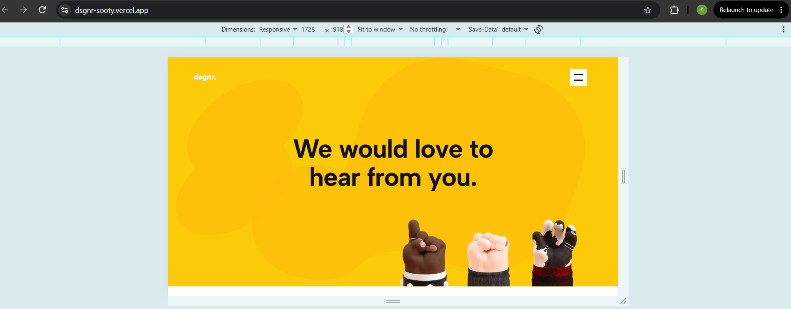
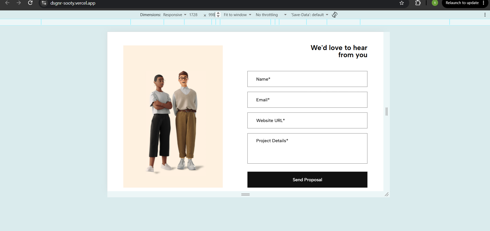
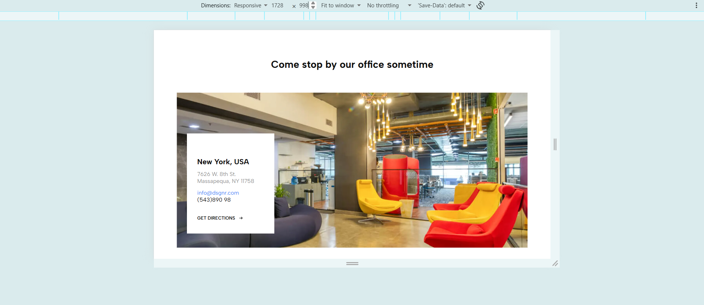
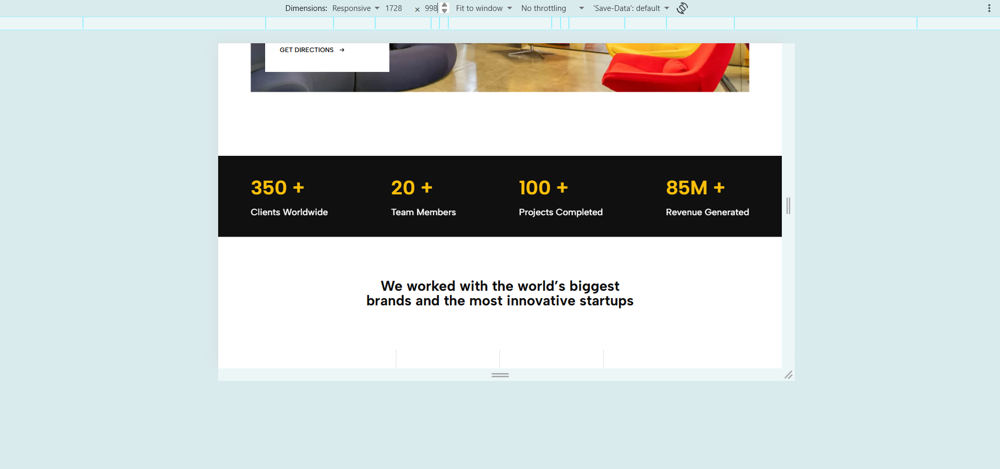

# dsgnr. — Contact Page

A responsive Contact page for the design agency **dsgnr.**, built in React from a Figma design.

- **Live:** https://dsgnr-sooty.vercel.app/
- **Repository:** https://github.com/sohamdc/dsgnr


**Lighthouse (live link, mobile mode)**


Performance: **** · Accessibility: **___** 

## Run locally

```bash
npm install
npm run dev      
npm run build   
npm run preview  
```


## Tech choices and why


- **React + Vite** : Required by the brief. Vite gives instant dev reloads and a small, code-split production build. 
- **CSS Modules** : Styles are scoped to each component, so there are no class-name clashes and Plain CSS also makes it easier to match Figma values exactly.
- **A "design unit" (`--u`)**:  The Figma frame is 1728px wide. --u equals 1px at 1728 and shrinks with the screen width, so every Figma size scales together. Widths use CSS grid fractions so nothing overflows sideways. 
- **Content in `src/data/content.js`**  All text, links, stats, logos and field definitions are in one file and are rendered with `map()`. 
-**Small reusable components** : `Field` , `Button`, `SectionHeading`, `Reveal`, `StatItem`. The form logic is in the `useContactForm` hook and the rules are in `utils/validators.js`. 
-**Framer Motion (LazyMotion)** : Light scroll reveals, staggered hands, menu links and form messages. The lazy build adds about 28 KB gzipped and loads after first paint. Only `opacity` and `translate` are animated. 
- **WebP and SVG assets** : Photos are WebP, icons and logos are SVG. The hand images came out of Figma as 4–7 MB SVG wrappers around huge PNGs, and are now 8–26 KB each. 

## Decisions where Figma wasn't specific

- **Font:** Figma uses *Roobert TRIAL*, a trial-only paid font. I compared 14 Google Fonts against the Figma heading and chose **Albert Sans**, which has the closest letterforms (straight-tailed "y", double-story "a").
- **Breakpoints:** between 901px and 1728px the page scales proportionally (1440 and 1024 keep the desktop layout). At **900px and below** the layout rearranges, and at **600px and below** there are a few more changes.
  - Tablet (≤900px): the form stacks under the illustration, the address card sits below the photo, stats become 2 x 2, logos 2 columns, the CTA stacks, and the footer columns reflow.
  - Mobile (≤600px): everything is a single column, and the mouse scroll icon is hidden because it is not required for mouse users.
- **Mobile menu:** a full-screen black overlay with large white links. The hamburger turns into an X. It closes on **Escape** or when a link is clicked, locks page scroll while open, and keeps keyboard focus inside it. Menu links point to the sections on this page (Home, Contact, Office, Clients).
- **Form:**
  - Labels sit inside the field like Figma and float up when you focus or type. They are real `<label>` elements.
  - Errors appear in the gap under each field, so the layout never shifts. Error color `#C62828`, success color `#1B7A3E` (both pass contrast).
  - Success and error messages appear under the Send button.
- **Hover and focus states** (not in Figma): black buttons turn yellow (white on the CTA), links underline or turn gold, field borders darken, logo cells get a soft yellow and slight zoom. Every interactive element has a visible focus outline (white on dark sections).
- **Illustration:** the source image in Figma is only 256 x 444 px. I upscaled it 4x with an AI super-resolution model and export it as a 2x WebP so it stays sharp on high-density screens.
- **Footer and social links:** there are no other pages, so footer links point to sections on this page. Social icons link to each platform's home page. The phone number is shown as designed (8 digits).
- **Stats:** the numbers count up once when scrolled into view. 

## Folder structure

```
src/
  assets/       images, SVG logos and icons
  components/   Button, Field, Reveal, SectionHeading, StatItem
  data/         content.js (all text, links, stats, logos)
  hooks/        useContactForm, useCountUp
  sections/     Header, Hero, ContactForm, Office, Stats, Brands, CtaBanner, Footer
  styles/       tokens.css (colors, sizes, --u), global.css
  utils/        validators.js
```

## Screenshots

- **Desktop (1728px)**  
|  |  |
 |  |
 |  |
 |


- **Mobile (375px)**


## What I would improve with more time

- Self-host Albert Sans to remove the Google Fonts request.
- Replace the placeholder footer and social links with real destinations.
- Content and Images from Database so it may be usefull for for other clients.
 